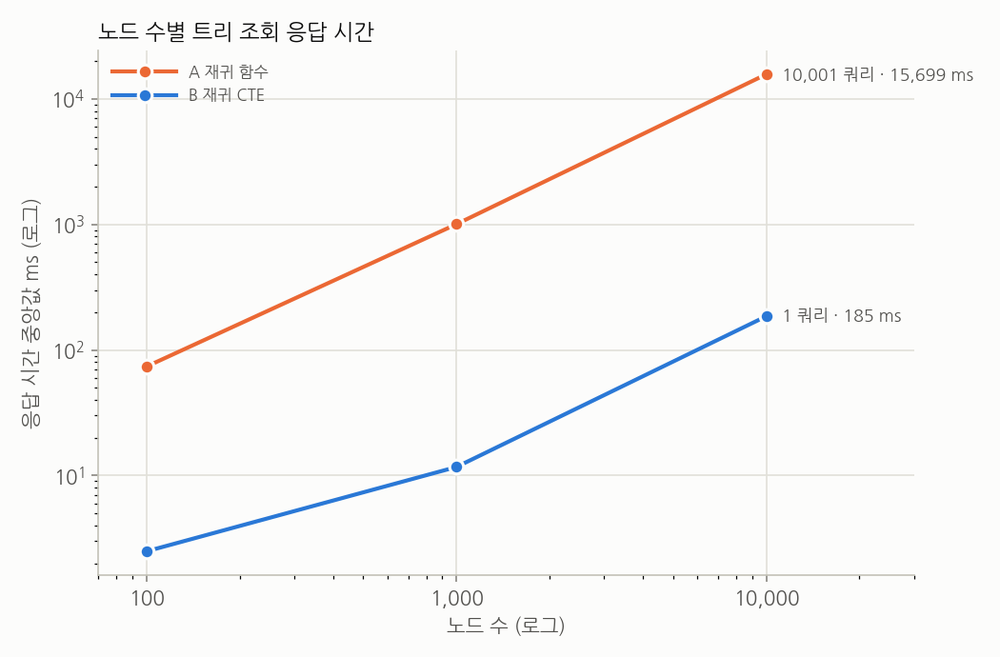
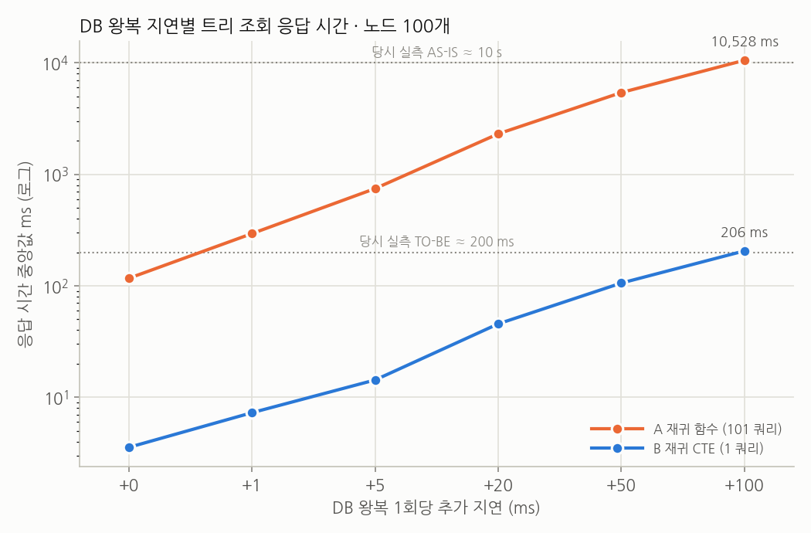

# 실험 기록: 트리 조회 쿼리, 재귀 함수(AS-IS) vs 재귀 CTE(TO-BE)

트리 조회 쿼리의 두 방식을 같은 결과 조건에서 비교한 실험 기록입니다. 프로젝트 소개는 [README](../README.md)에 있습니다.

## 요약

- **실험 1 (지연 없음)**: 노드 100 / 1,000 / 10,000개에서 A는 101 / 1,001 / 10,001번 쿼리에 73.7 / 1,003.7 / 15,698.7 ms, B는 1번 쿼리에 2.5 / 11.7 / 185.5 ms가 걸렸습니다 (29.6 / 85.9 / 84.6배).
- **실험 2 (노드 100개, DB 왕복 지연)**: 지연 +100 ms에서 A 10,528.1 ms, B 205.6 ms (51.2배). 기준값인 당시 실측 약 10초 → 약 200ms와 같은 수준입니다.
- **EXPLAIN ANALYZE**: A의 자식 조회 1회는 DB 안에서 0.016 ms(노드 100개) / 0.96 ms(노드 1만 개), B의 재귀 CTE 전체는 0.24 ms / 21 ms입니다.

## 목적

- 트리 조회에서 AS-IS(노드마다 자식 조회)와 TO-BE(재귀 CTE 한 번)의 쿼리 수와 응답 시간을, 두 방식의 결과가 같다는 조건에서 비교합니다.
- 당시 실측값(카테고리 100개, Postman으로 잰 API 전체 응답 시간 약 10초 → 약 200ms)이 DB 왕복 지연 조건에서 재현되는지 확인합니다.

## 실험 환경과 재현 정보

| 항목 | 값 |
| --- | --- |
| 측정일 | 2026-10-28 (노드 100개 EXPLAIN은 2026-10-29 생성) |
| 측정 코드 | 이 문서와 같은 커밋 |
| 호스트 | Intel Core i7-10750H (12 스레드), Windows WSL2 (커널 6.6.114.1) |
| Docker | Docker Desktop 24.0.7, 할당 메모리 약 7.8 GiB |
| DB | PostgreSQL 16.4 (`postgres:16.4` 이미지, 기본 설정) |
| 앱 | Python 3.12.16 (`python:3.12-slim`), Flask 3.0.3, Flask-SQLAlchemy 3.1.1, SQLAlchemy 2.0.36, psycopg 3.2.3 |
| 프록시 | toxiproxy 2.9.0 (`ghcr.io/shopify/toxiproxy:2.9.0`) |
| 접속 경로 | 실험 1: bench → db 컨테이너 / 실험 2: bench → toxiproxy → db 컨테이너 |

## 실험 설계

### 데이터

`categories(id, parent_id, name)` 테이블 하나를 씁니다([모델 구조](#모델-구조)). `parent_id`에는 FK 제약과 인덱스가 없습니다.

| 노드 수 | 최대 깊이 | 난수 seed | 트리 해시 (sha256 앞 12자리) |
| ---: | ---: | ---: | --- |
| 100 | 4 | 4,200,100 | `459b2cde9737` |
| 1,000 | 5 | 4,201,000 | `68913a67b71c` |
| 10,000 | 6 | 4,210,000 | `85dd402f867e` |

- 난수 seed는 `random.Random(SEED * 100_000 + n)`이고 `SEED = 42`입니다([seed.py](../seed.py)).
- 생성 규칙: 루트 1개에서 시작해, 자식 자리가 남은 노드(자식 10개 미만, 최대 깊이 미만) 중 하나를 무작위로 골라 새 노드를 붙입니다. 노드 수에 도달하면 id를 BFS 순서로 1부터 다시 매깁니다.
- 노드 이름은 모두 `node-{id}`입니다.
- 트리 해시는 모든 행의 `(id, parent_id, name)`을 이은 문자열의 sha256입니다. `python seed.py <노드 수>` 출력의 `hash=`와 비교하면 같은 트리인지 확인할 수 있습니다.

### 비교 방식

실험 대상은 루트부터 트리 전체를 반환하는 **트리 조회 쿼리**입니다. 출력 형태는 `{"id", "name", "children": [...]}`로 고정하고, children은 id 순으로 정렬합니다.

| 방식 | 조회 방법 | 쿼리 수 |
| --- | --- | ---: |
| **A (AS-IS)** | 루트부터 노드마다 자식 조회 | 1 + N |
| **B (TO-BE)** | 재귀 CTE 한 번으로 전체 조회 → Python에서 조립 | 1 |

모델에는 같은 CTE를 쓰는 검색 함수 `get_result_recursive`도 있지만, 측정 대상은 아닙니다([참고: 검색 함수](#참고-검색-함수-get_result_recursive)).

### 측정 방법

- **정확성**: 조건마다 `assert a == b`가 통과해야 측정을 진행합니다. 결과에 seed의 모든 노드가 한 번씩 들어 있는지도 확인합니다.
- **쿼리 수**: SQLAlchemy `before_cursor_execute` 이벤트로 집계합니다.
- **응답 시간**: `time.perf_counter`로 함수 호출 시간을 잽니다.
- **절차**: 조건마다 A/B를 1회씩 실행해 워밍업과 정확성 검증을 하고, 이어서 A → B를 5라운드 번갈아 실행합니다. 표의 값은 5회의 중앙값이고, 최솟값과 최댓값은 CSV에 있습니다.
- **세션**: 실행마다 새로 만들어서, ORM identity map 캐시가 결과를 재사용하지 않게 합니다.
- **통계**: seed 직후 `ANALYZE categories`를 실행합니다.

### 실험 1: 노드 수별

- 노드 수 100 / 1,000 / 10,000 × 방식 2 = 6개 조건
- 네트워크 지연을 추가하지 않습니다.

### 실험 2: DB 왕복 지연

bench와 db 사이에 [toxiproxy](https://github.com/Shopify/toxiproxy)를 두고, db 응답에 지연을 넣습니다.

| 설정 | 값 |
| --- | --- |
| 노드 수 | 100 |
| 프록시 | name `postgres`, listen `0.0.0.0:5433`, upstream `db:5432` |
| toxic | type `latency`, stream `downstream`(db → bench 방향 응답), toxicity 1.0(모든 응답에 적용) |
| latency | 0 / 1 / 5 / 20 / 50 / 100 ms (0은 toxic 없음) |
| jitter | 0 ms |
| 왕복 실측 | 조건마다 `SELECT 1`을 10회 실행한 중앙값 |

## 모델 구조

### ORM ([models.py](../models.py))

```python
class Category(db.Model):
    __tablename__ = "categories"

    id = db.Column(db.Integer, primary_key=True, autoincrement=True, nullable=False)
    parent_id = db.Column(db.Integer, foreign_key=[id])  # SQLAlchemy가 이 인자를 무시해서 FK 제약은 생기지 않음
    name = db.Column(db.String)

    # get_descendants가 Category.parent를 쓴다. FK 제약이 없어서 조인 조건을 직접 적는다.
    parent = db.relationship(
        "Category",
        primaryjoin="Category.parent_id == Category.id",
        foreign_keys=[parent_id],
        remote_side=[id],
    )
```

### 테이블 ([schema.sql](../schema.sql))

```sql
CREATE TABLE categories (
    id        SERIAL PRIMARY KEY,
    parent_id INTEGER,          -- 부모 카테고리 id, 루트는 NULL (FK 제약, 인덱스 없음)
    name      VARCHAR
);
```

| 컬럼 | 타입 | 설명 |
| --- | --- | --- |
| `id` | `SERIAL` PK | 카테고리 id. seed가 BFS 순서로 1부터 매긴다 |
| `parent_id` | `INTEGER` NULL | 부모 id. 루트만 `NULL` |
| `name` | `VARCHAR` | `node-{id}` |

## 쿼리

ORM 코드와, 그 코드가 실제로 실행하는 SQL을 함께 적었습니다. SQL은 읽기 쉽게 별칭(`AS categories_id` 등)과 타입 캐스트를 지운 것이고, 실제로 실행된 원문은 [results/explain/](../results/explain/)에 있습니다.

| 방식 | 쿼리 수 | 사용한 쿼리 |
| --- | ---: | --- |
| A | 1 + N | ① 루트 조회 1번 + ② 자식 조회 N번 |
| B | 1 | ③ 재귀 CTE |

### 재귀 CTE (`Category.get_recursive_cte`)

B 방식의 쿼리 ③이 이 CTE입니다. 검색 함수 `get_result_recursive`도 같은 CTE를 씁니다.

```python
@classmethod
def get_recursive_cte(cls):
    start_query = db.session.query(
        cls.id,
        cls.name,
        postgresql.array([cls.parent_id]).label("c_path"),
        literal(1).label("depth"),
    ).filter(
        cls.parent_id.is_(None)
    ).cte("category_cte", recursive=True)  # 재귀 쿼리임을 여기서 표현합니다

    repeat_query = db.session.query(
        cls.id,
        cls.name,
        start_query.c.c_path + postgresql.array([cls.parent_id]),
        start_query.c.depth + 1,
    ).filter(
        cls.parent_id == start_query.c.id
    )
    return start_query.union_all(repeat_query)
```

```sql
WITH RECURSIVE category_cte(id, name, c_path, depth) AS (
    -- 시작: 루트
    SELECT id, name, ARRAY[parent_id] AS c_path, 1 AS depth
    FROM categories
    WHERE parent_id IS NULL
    UNION ALL
    -- 반복: 직전 단계 노드의 자식
    SELECT categories.id, categories.name,
           category_cte.c_path || ARRAY[categories.parent_id],
           category_cte.depth + 1
    FROM categories, category_cte
    WHERE categories.parent_id = category_cte.id
)
```

`c_path`는 자기 자신을 뺀 조상 id 목록입니다(맨 앞은 루트의 시작값 `NULL`). 예를 들어 루트(1) → 2 → 15 경로의 15번 노드는 `c_path = {NULL, 1, 2}`, `depth = 3`입니다. 마지막 원소가 부모 id이므로 Python에서 트리를 조립할 때 이 값을 씁니다.

### A (AS-IS): 노드마다 자식 조회

```python
def tree_a(root_id):
    return Category.get(root_id).get_descendants()

@classmethod
def get(cls, id_):
    """특정 id 값의 데이터를 가져옵니다."""
    return cls.query.filter(cls.id == id_).one_or_none()

def get_descendants(self):
    """category 인스턴스의 모든 자식(자손)을 가져와서 dictionary 형태로 보내줍니다."""
    children = Category.query.filter(Category.parent == self).all()
    children_list = []
    for child in children:
        ele = child.get_descendants()
        children_list.append(ele)
    children_list.sort(key=lambda ele: ele["id"])  # 비교용으로 출력 순서만 고정
    return {"id": self.id, "name": self.name, "children": children_list}
```

```sql
-- ① 루트 조회 (1번)
SELECT id, parent_id, name FROM categories WHERE id = 1;

-- ② 자식 조회 (노드마다 1번씩, 총 N번. 자식이 없는 노드도 조회한다)
SELECT id, parent_id, name FROM categories WHERE parent_id = :id;
```

### B (TO-BE): 재귀 CTE 한 번

```python
def tree_b(root_id):
    rows = db.session.query(Category.get_recursive_cte()).all()
    return assemble(rows)  # c_path[-1]을 부모 id로 써서 Python에서 조립

def assemble(rows):
    nodes = {row.id: {"id": row.id, "name": row.name, "children": []} for row in rows}
    root = None
    for row in sorted(rows, key=lambda row: row.id):
        parent_id = row.c_path[-1]
        if parent_id is None:
            root = nodes[row.id]
        else:
            nodes[parent_id]["children"].append(nodes[row.id])
    return root
```

```sql
-- ③ 트리 전체 (1번)
WITH RECURSIVE category_cte(id, name, c_path, depth) AS ( ... 공통 CTE ... )
SELECT id, name, c_path, depth
FROM category_cte;
```

### 참고: 검색 함수 (`get_result_recursive`)

모델에는 같은 재귀 CTE에 이름 조건을 붙인 검색 함수가 있습니다. 이번 실험에서는 측정하지 않습니다.

```python
@classmethod
def get_result_recursive(cls, term):
    """재귀 쿼리 ORM을 이용해 데이터를 가져올 수 있습니다."""
    recursive_query = cls.get_recursive_cte()
    query = db.session.query(recursive_query)

    return query.filter(
        recursive_query.c.name.like(f"%{term}%")
    ).all()
```

raw SQL로 쓰면 다음과 같습니다.

```sql
WITH RECURSIVE category_cte AS (
    SELECT  -- 시작 쿼리를 작성합니다, 일반적으로 시작 쿼리는 parent_id가 null인 경우가 됩니다.
        id,
        ARRAY[parent_id] AS "c_path",
        "name",
        1 AS "depth"
    FROM categories
    WHERE parent_id IS NULL
    UNION ALL
    SELECT  -- 재귀로 돌릴 쿼리를 작성하여 UNION ALL 합니다
        c.id,
        category_cte."c_path" || c.parent_id,  -- path를 계속 찾아 줌
        c."name",
        category_cte."depth" + 1  -- 현재 데이터의 depth를 찾아 줌
    FROM categories c, category_cte
    WHERE c.parent_id = category_cte.id
)
SELECT * FROM category_cte
WHERE "name" LIKE '%검색어%';
```

## 결과

원본 데이터는 [results/](../results/)에 있습니다(`results.csv`, `latency.csv`, `explain/`).

### 실험 1: 노드 수별



| 노드 수 | A 쿼리 수 | B 쿼리 수 | A (ms) | B (ms) | A / B |
| ---: | ---: | ---: | ---: | ---: | ---: |
| 100 | 101 | 1 | 73.7 | 2.5 | 29.6x |
| 1,000 | 1,001 | 1 | 1,003.7 | 11.7 | 85.9x |
| 10,000 | 10,001 | 1 | 15,698.7 | 185.5 | 84.6x |

- A의 쿼리당 시간(응답 시간 ÷ 쿼리 수)은 0.73 ms(노드 100개), 1.00 ms(1,000개), 1.57 ms(1만 개)입니다.
- 노드 수가 10배 늘 때 A의 응답 시간은 13.6배(100 → 1,000), 15.6배(1,000 → 1만) 늘었습니다.

### EXPLAIN ANALYZE

실제로 실행된 SQL과 파라미터를 그대로 `EXPLAIN (ANALYZE, BUFFERS)`로 돌린 결과입니다. 원문은 [results/explain/](../results/explain/)에 있습니다.

| 쿼리 | 노드 100개 | 노드 1만 개 |
| --- | --- | --- |
| A: 자식 조회 1회 (루트의 자식) | Seq Scan, 100행 중 90행 버림, **0.016 ms** | Seq Scan, 1만 행 중 9,990행 버림, **0.96 ms** |
| B: 재귀 CTE 전체 | 재귀 반복 4회마다 Hash Join + Seq Scan, **0.24 ms** | 재귀 반복 6회마다 Hash Join + Seq Scan, **21 ms** |

- **A**: 자식 조회 1회가 `parent_id` 조건에 맞는 행을 찾으려고 테이블 전체를 읽습니다. 루트를 조회하면 자식 10행만 결과로 남고, 나머지는 버립니다.
- **B**: 노드 1만 개에서 DB 실행은 21 ms이고, 앱에서 잰 전체 시간은 185.5 ms입니다.

### 실험 2: DB 왕복 지연



| 추가 지연 | SELECT 1 왕복 (ms) | A 쿼리 수 | B 쿼리 수 | A (ms) | B (ms) | A / B |
| ---: | ---: | ---: | ---: | ---: | ---: | ---: |
| +0 ms | 1.0 | 101 | 1 | 117.0 | 3.6 | 32.8x |
| +1 ms | 1.7 | 101 | 1 | 294.4 | 7.3 | 40.4x |
| +5 ms | 6.2 | 101 | 1 | 745.3 | 14.3 | 52.1x |
| +20 ms | 21.2 | 101 | 1 | 2,306.5 | 45.6 | 50.6x |
| +50 ms | 51.1 | 101 | 1 | 5,408.6 | 105.9 | 51.1x |
| **+100 ms** | 101.8 | 101 | 1 | **10,528.1** | **205.6** | 51.2x |

- +100 ms에서 A 10,528.1 ms, B 205.6 ms로, 기준값(약 10초 / 약 200ms)보다 각각 5%, 3% 큽니다.
- +100 ms에서 A는 왕복 약 103번분(10,528.1 ÷ 101.8), B는 약 2번분(205.6 ÷ 101.8)의 시간이 걸렸습니다.
- +20 ms 이상에서 A/B 배율은 50.6~51.2배입니다. 쿼리 수보다 왕복이 1번씩 더 있다고 계산한 비율 (101+1) ÷ (1+1) = 51과 같습니다.
- +0 ms 행은 toxiproxy를 거치므로 실험 1의 노드 100개 값(73.7 / 2.5 ms)보다 느립니다.

## 한계

- **당시 환경은 확인할 수 없습니다.** 당시 DB 왕복이 왜 100 ms 수준이었는지(리전, 커넥션 설정 등)는 알 수 없습니다. 실험 2가 보여 주는 범위는 "왕복 100 ms인 환경이라면, 쿼리만 바꿨을 때 기준값과 같은 수준의 숫자가 나온다"까지입니다.
- **HTTP 비용을 포함하지 않습니다.** 기준값은 Postman으로 잰 API 전체 시간이고, 이 실험은 함수 호출 시간만 잽니다.
- **절댓값은 실행마다 흔들립니다.** 같은 조건을 반복 실행하면 절댓값이 1.5배 넘게 차이 나기도 합니다. 쿼리 수와 A/B 배율의 크기(수십 배 이상)는 매번 같았습니다. 10 ms 이하 값끼리의 작은 차이는 잡음 범위입니다.
- **로컬 환경입니다.** 실험 1은 같은 머신 안의 컨테이너끼리 접속해서 왕복이 1 ms 미만입니다. 노드가 많은 조건에는 지연을 넣지 않았습니다(노드 1만 개에 +100 ms를 넣으면 A 한 번에 17분 이상).
- **합성 데이터입니다.** seed를 고정한 무작위 트리이고, 실제 카테고리 데이터가 아닙니다.

## 재현 방법

```bash
docker compose up --build --exit-code-from bench
```

- 테이블 생성 → seed → 정확성 검증 → 실험 1 → EXPLAIN → 실험 2 순서로 실행하고, 결과를 `results/`에 저장합니다.
- 같은 트리인지는 출력의 `[seed] ... hash=`를 위 [데이터](#데이터) 표의 트리 해시와 비교해 확인합니다.
- 다른 실행 옵션(검증만, 지연 조건만, 데이터만 넣기)은 [README](../README.md#실행-방법)에 있습니다.
